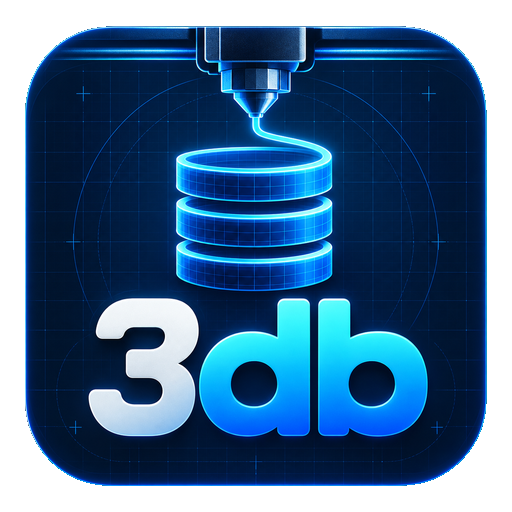
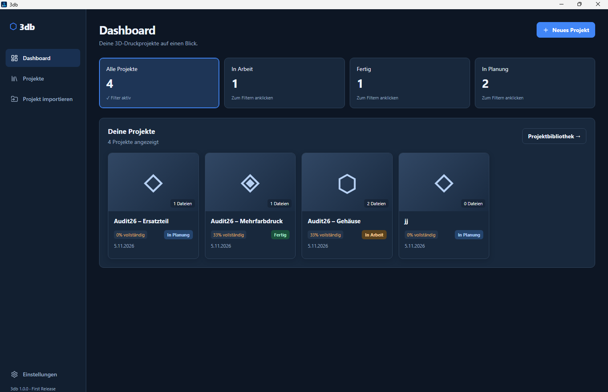
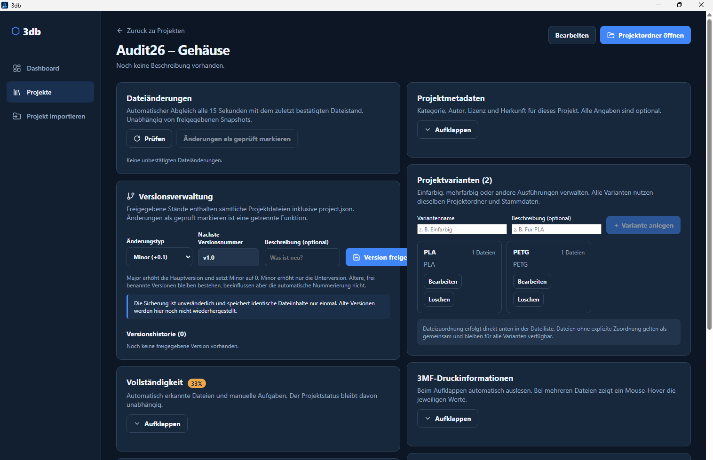

# 3db – 3D-Druck-Datenbank

**Deine Projekte. Deine Dateien. Deine Datenbank.**

3db ist eine Open-Source-Desktopanwendung für Windows zur lokalen Verwaltung eigener 3D-Druckprojekte.

Modelle, Druckdateien, Bilder, Dokumente, Projektvarianten und Versionen werden übersichtlich an einem zentralen Ort organisiert.

[English documentation](README.md)

  

## Screenshots

### Dashboard

### Projektdetails, Varianten und Versionierung

## Funktionen

- Projekte anlegen, bearbeiten und archivieren
- STL-, 3MF-, Bild- und PDF-Dateien verwalten
- Projekte mit Tags und Kategorien organisieren
- Projekte suchen und filtern
- Mehrere Varianten je Projekt verwalten
- Dateiänderungen erkennen und Versions-Snapshots erstellen
- Projektordner direkt öffnen
- Projektübersicht individuell anpassen
- Heller, dunkler und systemabhängiger Darstellungsmodus
- Lokale Datenspeicherung mit SQLite

## Erste Veröffentlichung

**3db 1.0.0 – First Release**

Die erste öffentliche Version konzentriert sich auf die zuverlässige lokale Projekt- und Dateiverwaltung.

Weitere Informationen stehen in den [Release Notes](docs/releases/v1.0.0.md) und im [Changelog](CHANGELOG.md).

## Installation

3db ist derzeit für Windows x64 vorgesehen.

Der Installer wird mit dem GitHub-Release bereitgestellt.

## Datenschutz und Datenverwaltung

3db verwaltet Projektdaten lokal und verwendet eine SQLite-Datenbank sowie organisierte Projektordner.

Vor Aktualisierungen, Migrationen und Wiederherstellungen sollten unabhängige Sicherungen erstellt werden.

## Technologie

Tauri, Rust, React, TypeScript, Vite und SQLite.

## Lizenz

3db wird unter der [MIT-Lizenz](LICENSE) veröffentlicht. Copyright (c) 2026 FabimachtSachen.

**3db – Deine Projekte. Deine Dateien. Deine Datenbank.**
