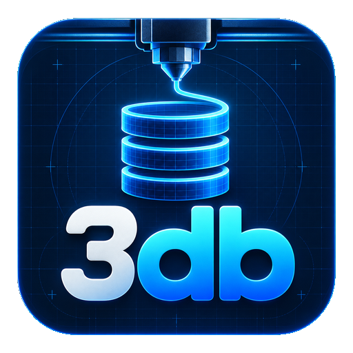
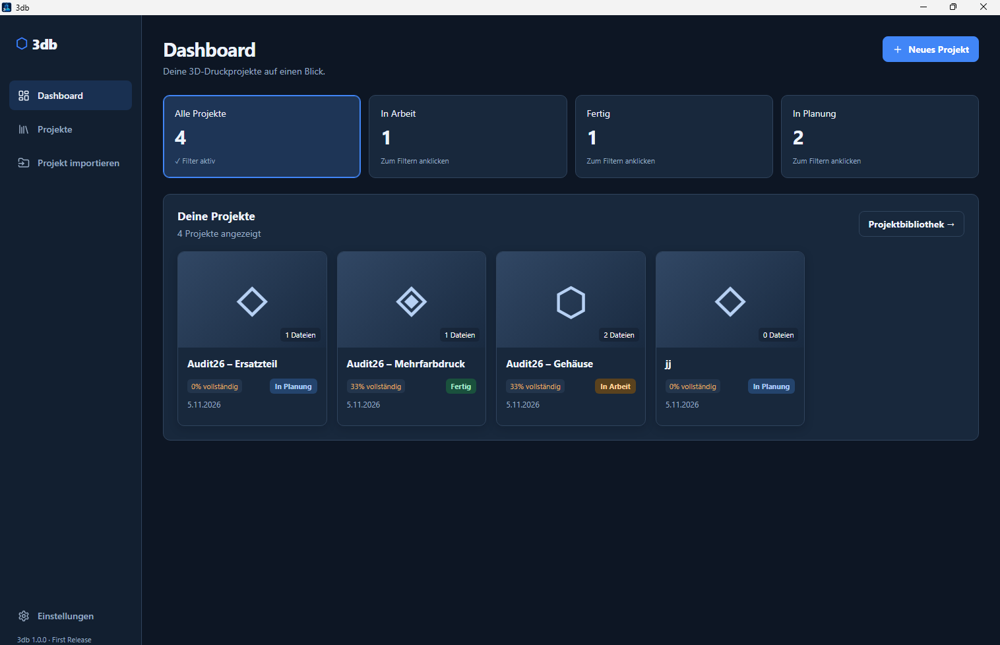
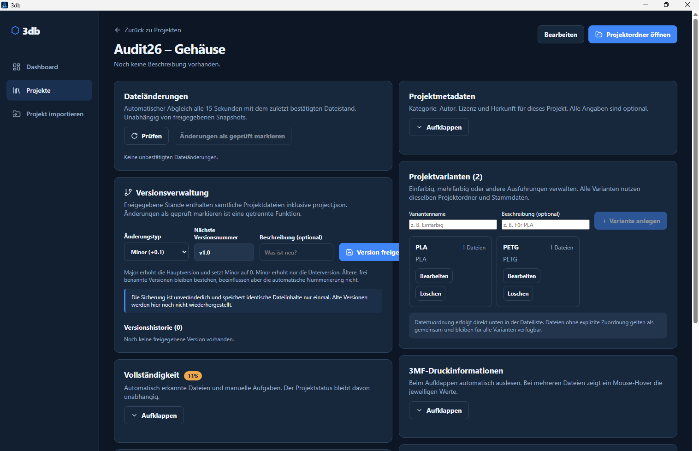

# 3db – 3D Print Database

**Your projects. Your files. Your database.**

3db is an open-source Windows desktop application for organizing and managing personal 3D printing projects.

Keep your models, print files, images, documents, variants, and project versions organized in one local workspace.

[Deutsche Dokumentation](README.de.md)

  

## Screenshots

### Dashboard

### Project details, variants and versioning

## Features

- Create, edit, archive, and organize projects
- Import and manage STL, 3MF, images, and PDF documents
- Organize projects using tags and categories
- Search and filter your project collection
- Manage multiple variants of a project
- Detect file changes and create version snapshots
- Access project folders directly
- Customize the project overview
- Light, dark, and system appearance modes
- Local data storage using SQLite

## First Release

**3db 1.0.0 – First Release**

The initial public release focuses on reliable local project and file management.

See [Release Notes](docs/releases/v1.0.0.md) and [Changelog](CHANGELOG.md).

## Installation

3db is currently available for Windows x64.

Download the installer from the GitHub Releases section once the release is published.

See [Installation Guide](docs/installation.md).

## Data and versioning

3db uses managed project folders, local metadata, and an SQLite database.

Read [Data and Versioning](docs/data-and-versioning.md) before moving, restoring, or migrating an existing project library.

## Technology

- Tauri
- Rust
- React
- TypeScript
- Vite
- SQLite

## License

3db is licensed under the [MIT License](LICENSE). Copyright (c) 2026 FabimachtSachen.

## Project philosophy

3db is designed as a local, personal project manager rather than a community platform.

**3db – Deine Projekte. Deine Dateien. Deine Datenbank.**
